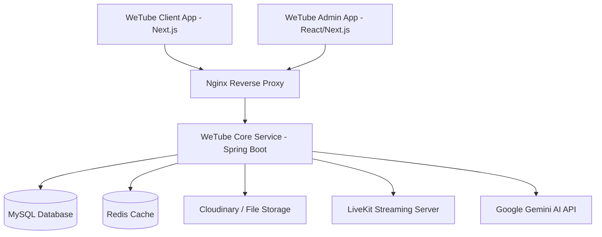

# BUSINESS REQUIREMENTS DOCUMENT (BRD)
## Dự án: WeTube - Nền tảng Chia sẻ Video, Livestream & Phòng Xem Chung tích hợp AI

---

### **THÔNG TIN TÀI LIỆU**
* **Tên dự án:** WeTube (Web & Mobile Video Streaming Platform)
* **Phiên bản:** 1.0.0
* **Ngày tạo:** 25/09/2026
* **Trạng thái:** Đã phê duyệt (Approved)
* **Tác giả:** Đội ngũ Phát triển Hệ thống WeTube

---

## 1. TỔNG QUAN DỰ ÁN (EXECUTIVE SUMMARY)

### 1.1. Bối cảnh & Tầm nhìn
Trong kỷ nguyên phát triển mạnh mẽ của nội dung số, nhu cầu tiếp cận các video đa ngôn ngữ, tương tác thời gian thực và xem nội dung chung trực tuyến ngày càng tăng cao. Tuy nhiên, các nhà sáng tạo nội dung (Creators) gặp nhiều rào cản về thời gian khi làm phụ đề và dịch thuật thủ công, trong khi khán giả thiếu các công cụ tương tác trực tiếp đồng bộ khi xem video cùng nhau.

**WeTube** được xây dựng nhằm giải quyết triệt để các bài toán trên bằng cách kết hợp nền tảng chia sẻ video truyền thống với công nghệ **Trí tuệ nhân tạo (Google Gemini AI)**, **Livestream độ trễ thấp (LiveKit)** và **Phòng xem chung (Watch Party)**, mang đến một hệ sinh thái giải trí số toàn diện và thương mại hóa hiệu quả cho Creator.

### 1.2. Mục tiêu dự án
* Xây dựng nền tảng phát video đa phương tiện chất lượng cao hỗ trợ video dài (VOD) và video ngắn (Shorts).
* Tự động hóa 90% quy trình tạo phụ đề và dịch đa ngôn ngữ cho video nhờ AI.
* Cung cấp trải nghiệm tương tác thời gian thực: Livestream chất lượng cao và Phòng xem chung (Watch Party).
* Xây dựng mô hình thương mại hóa bền vững cho Creator thông qua các gói đăng ký Premium và Hội viên kênh (Member Tier).

---

## 2. MỤC TIÊU KINH DOANH & CHỈ SỐ ĐO LƯỜNG (BUSINESS OBJECTIVES & KPIS)

| Mục tiêu kinh doanh | Chỉ số đo lường hiệu quả (KPIs) |
| :--- | :--- |
| **Tối ưu hóa năng suất Creator** | Giảm thời gian làm phụ đề/dịch thuật từ 3–5 giờ/video xuống dưới 1 phút. |
| **Tăng trưởng người dùng chủ động** | Đạt 100,000+ người dùng đăng ký active hàng tháng (MAU) trong năm đầu tiên. |
| **Tăng tỷ lệ giữ chân (Retention)** | Đẩy thời lượng xem trung bình (Watch time) tăng 35% nhờ tính năng Phòng xem chung (Watch Room). |
| **Đa dạng hóa doanh thu** | Đạt tỷ lệ 5%–8% người dùng nâng cấp Premium / Đăng ký Hội viên kênh. |

---

## 3. ĐỐI TƯỢNG NGƯỜI DÙNG & PHÂN KHÚC (USER PERSONAS)

1. **Người xem phổ thông (Viewers):**
   * Nhu cầu: Xem video giải trí/học tập, xem Shorts, theo dõi nội dung đa ngôn ngữ có phụ đề tự động, rủ bạn bè vào phòng xem chung.
2. **Nhà sáng tạo nội dung (Content Creators / Streamers):**
   * Nhu cầu: Đăng tải video nhanh chóng, tự động tạo phụ đề AI, phát livestream tương tác với fan, kiếm tiền từ lượt xem và gói Hội viên Kênh.
3. **Người dùng trả phí (Premium Users & Channel Members):**
   * Nhu cầu: Tận hưởng các quyền lợi cao cấp (tắt quảng cáo, biểu tượng độc quyền, nội dung dành riêng cho hội viên).
4. **Quản trị viên (Administrators / Content Moderators):**
   * Nhu cầu: Duyệt nội dung, quản lý người dùng, xử lý báo cáo vi phạm (Report), theo dõi doanh thu và cấu hình hệ thống qua Portal riêng.

---

## 4. PHẠM VI DỰ ÁN (PROJECT SCOPE)

### 4.1. Trong phạm vi (In-Scope)
* **Quản lý Video & Shorts:** Upload, mã hóa, lưu trữ, phát video chất lượng cao, luồng video ngắn (Shorts).
* **Tích hợp AI Gemini:** Tự động tạo phụ đề (Auto Subtitle) và dịch thuật phụ đề đa ngôn ngữ.
* **Truyền hình trực tiếp (Livestreaming):** Tích hợp LiveKit Server cho phép stream video/audio thời gian thực.
* **Phòng xem chung (Watch Party Room):** Khởi tạo phòng, mời bạn bè, đồng bộ thời gian phát video và chat thời gian thực.
* **Tương tác Cộng đồng:** Bình luận phân cấp (nested comments), Thích/Dislike, Bài đăng (Post), Bình chọn (Poll Vote).
* **Thương mại hóa & Thanh toán:** Gói đăng ký Premium, Gói Hội viên Kênh (Member Tier), Cổng thanh toán trực tuyến & Lịch sử giao dịch.
* **Trang Quản trị Admin:** Bảng điều khiển phân tích, kiểm duyệt nội dung, quản lý báo cáo vi phạm.

### 4.2. Ngoài phạm vi (Out-of-Scope - Các pha sau)
* Tự động nối mạng quảng cáo bên thứ ba (Programmatic Ad Network).
* Mã hóa bản quyền video phức tạp (Digital Rights Management - DRM cấp doanh nghiệp cao cấp).

---

## 5. YÊU CẦU CHỨC NĂNG CHI TIẾT (FUNCTIONAL REQUIREMENTS)

### 5.1. Quản lý Tài khoản & Định danh (FR-1: Authentication & User Management)
* **FR-1.1:** Đăng ký, đăng nhập qua Email/Password và Đăng nhập nhanh bằng Google OAuth2.
* **FR-1.2:** Phân quyền hệ thống (User, Creator, Premium User, Admin).
* **FR-1.3:** Quản lý Hồ sơ cá nhân (Profile), cập nhật Avatar, Banner kênh, tiểu sử.

### 5.2. Quản lý Video, Shorts & Đề xuất (FR-2: Media Management & Recommendation)
* **FR-2.1:** Đăng tải video dài và video ngắn (Shorts) kèm thông tin tiêu đề, mô tả, hashtag, ảnh thu nhỏ (thumbnail).
* **FR-2.2:** Đánh chỉ mục (Indexing) và Tìm kiếm video theo từ khóa, danh mục (Categories) và thẻ (Tags).
* **FR-2.3:** Hệ thống gợi ý video (Recommendation Engine) cá nhân hóa dựa trên lịch sử tương tác và sở thích người dùng.
* **FR-2.4:** Quản lý Danh sách phát (Playlists): Danh sách Xem sau (Watch Later), Video đã thích, Lịch sử xem (History), Playlist tùy chỉnh.

### 5.3. Xử lý AI Phụ đề & Dịch thuật (FR-3: AI Subtitles & Translation)
* **FR-3.1:** Tự động chuyển đổi tiếng nói trong video thành văn bản phụ đề (Speech-to-Text) thông qua Google Gemini AI Client.
* **FR-3.2:** Hỗ trợ dịch tự động phụ đề sang nhiều ngôn ngữ phổ biến.
* **FR-3.3:** Cho phép Creator chỉnh sửa và phê duyệt bản phụ đề AI tạo ra trước khi xuất bản.

### 5.4. Truyền hình Trực tiếp (FR-4: LiveKit Streaming)
* **FR-4.1:** Khởi tạo phòng Livestream cho Creator với khóa Stream Key / Ingress URL.
* **FR-4.2:** Phát luồng video/audio thời gian thực độ trễ thấp thông qua LiveKit Engine.
* **FR-4.3:** Khán giả tham gia xem stream và chat trực tiếp trong khung Live Chat.

### 5.5. Phòng Xem Chung Đồng Bộ (FR-5: Real-time Watch Party Room)
* **FR-5.1:** Cho phép người dùng tạo Phòng xem chung (Watch Room) và chia sẻ liên kết mời bạn bè.
* **FR-5.2:** Đồng bộ trạng thái phát video (Play, Pause, Seek) giữa tất cả các thành viên trong phòng.
* **FR-5.3:** Khung trò chuyện nhóm (Group Chat) trong phòng xem chung.

### 5.6. Tương tác & Xây dựng Cộng đồng (FR-6: Social & Community Features)
* **FR-6.1:** Đăng ký kênh (Subscribe) và nhận thông báo khi kênh ra video/post/livestream mới.
* **FR-6.2:** Hệ thống bài đăng Cộng đồng (Community Posts): Đăng hình ảnh, văn bản và tạo Thăm dò ý kiến (Poll Vote).
* **FR-6.3:** Bình luận (Comments) hỗ trợ cấu trúc nhiều cấp (Parent-Child comment), Thích/Dislike bài đăng, video, bình luận.

### 5.7. Thương mại hóa & Thanh toán (FR-7: Monetization & Payment)
* **FR-7.1:** Quản lý các gói đăng ký tài khoản Premium (tắt quảng cáo, tính năng cao cấp).
* **FR-7.2:** Quản lý các cấp độ Hội viên Kênh (Member Tiers) do Creator thiết lập.
* **FR-7.3:** Tích hợp Cổng thanh toán (Payment Gateway) để xử lý nạp tiền / mua gói dịch vụ và lưu lịch sử giao dịch (Transactions).

### 5.8. Trang Quản trị & Kiểm duyệt (FR-8: Admin Portal & Moderation)
* **FR-8.1:** Thống kê tổng quan hệ thống: Số lượng User, Video đăng tải, lượt xem, doanh thu.
* **FR-8.2:** Tiếp nhận và xử lý báo cáo vi phạm nội dung (Report) từ người xem (xóa video, khóa tài khoản).
* **FR-8.3:** Quản lý danh mục (Categories), thẻ (Tags) và cấu hình hệ thống.

---

## 6. YÊU CẦU PHI CHỨC NĂNG (NON-FUNCTIONAL REQUIREMENTS - NFRS)

* **Hiệu năng (Performance):**
  * Thời gian phản hồi API trung bình $< 200ms$.
  * Tối ưu hóa luồng phát video streaming (HLS/DASH) với khả năng tự động điều chỉnh độ phân giải theo băng thông người dùng.
* **Bảo mật (Security):**
  * Mã hóa mật khẩu người dùng và xác thực ứng dụng bằng JWT Token & HttpOnly Cookies.
  * Sử dụng HTTPS cho toàn bộ truyền tải dữ liệu.
* **Tính sẵn sàng & Mở rộng (Availability & Scalability):**
  * Thiết kế kiến trúc Microservices / Containerization với Docker để dễ dàng mở rộng theo chiều ngang (Horizontal Scaling).
  * Sử dụng Redis làm bộ nhớ đệm (Caching) cho các truy vấn xem nhiều và xếp hạng video.
* **Trải nghiệm người dùng (UI/UX):**
  * Giao diện người dùng Next.js đáp ứng (Responsive) chuẩn xác trên cả Desktop và Mobile Browsers.
  * Hỗ trợ Chế độ tối/sáng (Dark Mode / Light Mode).

---

## 7. KIẾN TRÚC TỔNG QUAN HỆ THỐNG (HIGH-LEVEL ARCHITECTURE)

---

## 8. RỦI RO & GIẢI PHÁP GIẢM THIỂU (RISKS & MITIGATION)

| Rủi ro (Risk) | Mức độ | Giải pháp giảm thiểu (Mitigation Strategy) |
| :--- | :---: | :--- |
| **Chi phí API Gemini tăng cao khi tự động dịch nhiều video** | Trung bình | Sử dụng Redis caching lưu trữ phụ đề đã dịch, chạy background queue xử lý phụ đề theo đợt. |
| **Độ trễ truyền hình khi Livestream đông khán giả** | Cao | Sử dụng server LiveKit chuyên dụng tối ưu WebRTC protocols. |
| **Nội dung bản quyền hoặc vi phạm quy chuẩn** | Cao | Xây dựng công cụ Báo cáo (Report) nhanh cho người xem và Dashboard duyệt vi phạm ưu tiên cho Admin. |

---

## 9. KẾ HOẠCH TRIỂN KHAI & PHÊ DUYỆT (APPROVAL & TIMELINE)

* **Giai đoạn 1:** Hoàn thiện Core Engine (User Auth, Video Upload, Playback, MySQL Schema). *(Đã hoàn thành)*
* **Giai đoạn 2:** Tích hợp AI Gemini (Tự động phụ đề/dịch thuật) & LiveKit Streaming. *(Đã hoàn thành)*
* **Giai đoạn 3:** Xây dựng Watch Room, Post/Poll, Monetization (Premium/Member Tiers). *(Đã hoàn thành)*
* **Giai đoạn 4:** Kiểm thử tải, tối ưu SEO, nâng cấp UI/UX & Đóng gói Docker Deployment. *(Đang triển khai)*
